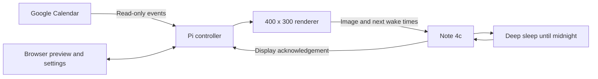

# Zectrix

**A quiet Google Calendar display for the Zectrix Note 4c. Updated at midnight, readable all day.**


*The actual display renderer, shown at 2x with fictional events. Halloween is an example illustration for this README; the automatic holiday list covers US federal and major Indian holidays.*

## Why this exists

I wanted a calendar I could glance at without opening another app. Today's date, what is coming up, and a small holiday illustration, on a screen that stays readable while it sleeps.

A Raspberry Pi reads Google Calendar and makes the image. The Note wakes at midnight, downloads it over Wi-Fi, and goes back to sleep. A short press of the front button can refresh it sooner.

This lives alongside my [ESL Home Hub](https://github.com/desigrit/esl-home-hub). The controller also works on its own, with a browser preview and settings page.

## What it does

- **Shows one selected Google calendar.** Choose its calendar ID in Settings. Access is read-only, through a service account or Desktop OAuth.
- **Fills the available space.** Events are grouped by date and continue into future months or years when the calendar is quiet. Long titles are fitted to the available pixel width.
- **Keeps the details consistent.** Date headings use `Wed 28 Oct`. Only today is highlighted. All-day events have no time; timed events use a centered dot between the time and title.
- **Refreshes once daily at midnight.** The schedule follows the selected timezone and daylight saving changes. The default timezone is America/Los_Angeles.
- **Sleeps between updates.** Unchanged images skip the slow screen refresh. Wi-Fi and display power are switched off during deep sleep.
- **Shows one upcoming holiday.** US federal holidays, including observed dates, plus a curated list of major Indian holidays, with small pixel illustrations.
- **Keeps the last successful calendar available.** Failed requests preserve saved events and the display. The controller shows when it last fetched data and when the Note last confirmed an image.

## Decisions behind Zectrix

**Design for a slow display.** A full four-color refresh takes more than ten seconds. The first version focuses on a calendar that is useful at a glance. Task selection, scrolling and a separate Microsoft To Do page remain future work.

**Use the space without stretching the layout.** I wanted more events when there was room, including events next year. Date groups stay compact, while the weekday, large date and month sit together in the sidebar. The renderer measures lettering instead of assuming that every character is the same width.

**Update the date at midnight.** I chose one scheduled update a day to reduce Wi-Fi activity and keep the date current at the start of each day. An event changed during the day appears at the next midnight update, or after a manual refresh.

**How I worked with AI.** Codex helped plan the screen, build the Pi controller and ESP32 firmware, connect Google Calendar, and add checks. I used photographs of the physical display to work through fonts, alignment and spacing.

**Where I pushed back.** I removed week numbers, calendar titles and account email addresses from the display. I asked for Calibri-like lettering, less awkward spacing in the date block, and more events instead of unused space. I also corrected a highlight that marked the first upcoming date when it should only mark today.

**What I would measure next.** Actual battery runtime, Wi-Fi recovery, and overnight updates on the physical Note. Software checks cover the schedule and daylight saving boundaries. They do not establish a measured battery life.

## How it works



The Pi creates the browser preview and device image from the same renderer. The device format is 30,000 bytes: four pixels per byte, using black, white, yellow and red indices. The Note checks the image digest before displaying it and reports a successful display operation back to the controller.

The Pi supplies the next 28 midnight wake times as absolute timestamps. The Note can keep its schedule during a temporary network outage. If its clock is lost or the saved schedule expires, it waits for a manual wake.

## Hardware

| Component | Requirement |
|---|---|
| Display | Zectrix **Note 4c Devkit**, 400 x 300, black / white / red / yellow |
| Display controller | SSD2683 |
| Processor | ESP32-S3, 16 MB flash and 8 MB PSRAM |
| Controller host | Raspberry Pi or another always-on computer with Python 3.11+ |
| Network | 2.4 GHz Wi-Fi and access from the Note to the controller |
| Power | Built-in 2,000+ mAh rechargeable battery, USB-C charging |

The firmware targets the four-color Note 4c. Check the [hardware guide](https://wiki.zectrix.com/en/hardware/note4c/quick-start) before flashing. Monochrome Note models use different display firmware.

## Run the controller

```bash
git clone https://github.com/desigrit/zectrix.git
cd zectrix
python3 -m venv .venv
. .venv/bin/activate
python -m pip install -e '.[test]'
python -m note_calendar.app --port 29175
```

Open [localhost:29175](http://127.0.0.1:29175). A fresh installation has no calendar selected. The **Busy**, **Quiet** and **Empty** previews use illustrative data and work before Google is connected.

On Windows, use `python` to create the environment, then run commands through `.\.venv\Scripts\python.exe` instead of activating it.

## Connect Google Calendar

### Service account for a Pi

1. In Google Cloud, enable the Calendar API, create a service account, and download its JSON key. See [Google's credential instructions](https://developers.google.com/workspace/guides/create-credentials#service-account).
2. Store the key outside version control, for example at `.data/google-service-account.json`. Keep the directory and key readable only by the service user.
3. In Google Calendar, share the calendar with the service account's email address using **See all event details**.
4. Set `NOTE_GOOGLE_SERVICE_ACCOUNT_FILE` to the key's absolute path before starting the controller. The sample systemd unit includes this option.
5. In the controller's Settings, enter the calendar ID from Google Calendar's **Settings and sharing > Integrate calendar**, choose the timezone, and save. Then select **Refresh calendar**.

For a local shell session:

```bash
export NOTE_GOOGLE_SERVICE_ACCOUNT_FILE="$PWD/.data/google-service-account.json"
python -m note_calendar.app --port 29175
```

The controller requests `calendar.events.readonly`. It reads the key in place, without copying it into the browser or asking for a recurring Google sign-in. A calendar shared with a service account can be addressed directly by ID even if it does not appear in that account's calendar list.

### Desktop OAuth

Leave `NOTE_GOOGLE_SERVICE_ACCOUNT_FILE` unset. Create a **Desktop app** OAuth client in Google Cloud, enable the Calendar API, and configure the consent screen for your account. Upload the client JSON in Settings, enter and save the calendar ID, and select **Connect Google Calendar**.

When the controller runs on the Pi, use a loopback tunnel for sign-in:

```bash
ssh -N -L 29176:127.0.0.1:29174 pi@raspberrypi.local
```

Replace the SSH user and hostname with your own, then open [localhost:29176](http://127.0.0.1:29176). Refresh tokens stay in the private data directory. Google projects in external Testing status can issue tokens that expire after seven days; see [Google's token expiration guidance](https://developers.google.com/identity/protocols/oauth2#expiration) when configuring unattended use.

## Run on a Raspberry Pi

Install the controller in a virtual environment, then edit [`deploy/note-calendar.service`](deploy/note-calendar.service) for your Linux user, checkout path, data directory and Pi address. Its values are examples.

```bash
mkdir -p .data
chmod 700 .data
sudo cp deploy/note-calendar.service /etc/systemd/system/note-calendar.service
sudo systemctl daemon-reload
sudo systemctl enable --now note-calendar
```

| Setting | Purpose |
|---|---|
| `NOTE_DATA_DIR` | Private runtime directory, defaulting to `.data/` in the working directory |
| `NOTE_DEVICE_URL` | Address the Note uses to reach the Pi, such as `http://192.168.1.100:29174` |
| `NOTE_GOOGLE_SERVICE_ACCOUNT_FILE` | Absolute path to an existing service account key; omit for Desktop OAuth |
| `NOTE_HUB_ALLOWED_HOSTS` | Optional comma-separated hostnames or IP addresses accepted by the ESL Hub proxy; set on the **hub service** |

Set `NOTE_DEVICE_URL` to the Pi's LAN IPv4 address and controller port. Port 29174 serves authenticated device requests. Direct browser administration is restricted to localhost, so use the SSH tunnel above or the optional hub integration. Reserve the Pi's address in your router so the Note can find it reliably.

### Optional ESL Home Hub tab

```bash
python deploy/install_hub.py --hub /path/to/esl-home-hub
```

The installer backs up the existing app and template, then adds **Family Calendar - Note4** beside Family Calendar. Restart the hub when its jobs are idle. Open `http://YOUR_PI:5000/?tab=note4`.

The proxy accepts `raspberrypi.local`, `raspberrypi` and loopback hosts by default. Add your own hostname and IP with `NOTE_HUB_ALLOWED_HOSTS` in the hub service environment. The controller keeps its own service, state and midnight schedule.

## Set up the Note

1. Connect the Note with a USB data cable and identify its serial port.
2. Back up all **16 MB** of its existing flash before replacing firmware. Store that backup privately; it can contain device configuration.
3. Build and upload the firmware below. If detection fails, hold the front BOOT button, briefly press the recessed RESET on the left, then release BOOT.
4. Join the `Note-Setup-...` network shown on the screen, using its temporary password. Open [192.168.4.1](http://192.168.4.1).
5. Enter your home Wi-Fi details, the Pi's controller address, and the device key from **Show pairing details** in the controller.
6. Save, rejoin your normal Wi-Fi, and allow the Note to finish its color refresh.

With the virtual environment active, replace `PORT` with the detected port, such as `COM5` on Windows or `/dev/ttyACM0` on Linux:

```bash
python -m pip install platformio esptool
python -m platformio run -d firmware
mkdir -p output
python -m esptool --chip esp32s3 --port PORT --baud 460800 read-flash 0 0x1000000 output/note4c-factory-backup.bin
python -m platformio run -d firmware -t upload --upload-port PORT
```

The partition table differs from the factory layout. Keep the full flash backup for rollback. Wi-Fi passwords and pairing keys are entered during setup and are not compiled into the firmware.

| Button | Behavior |
|---|---|
| Front button, short press | Wake and refresh manually |
| Front button, held for three seconds during wake | Open Wi-Fi and pairing setup |
| Up / Down | Reserved for later pages |
| Recessed RESET | Restart the device |

The setup screen pauses after 30 minutes without activity. Press the front button to wake it again. An open setup form keeps the setup session active.

## Holidays and illustrations

US dates are calculated from the [federal holiday rules](https://www.opm.gov/policy-data-oversight/pay-leave/federal-holidays/), including observed dates. Indian holidays are filtered from Google's Holidays in India calendar to the selection in [`holidays.py`](note_calendar/holidays.py), including Diwali, Holi, Eid, Onam and major national holidays. A bundled public cache provides dates through December 2027; live Google connections refresh it.

The original pixel sprites include lamps, a tree, a crescent, a flag, harvest artwork, a sun and the Halloween pumpkin and cat shown above. Halloween is used by the documentation fixture, without being added to the federal holiday list. Dates and artwork are separate, so an illustration does not determine a holiday's date.

Regenerate the README image using only fictional data:

```bash
python scripts/render_readme.py
```

## Battery and data

The screen holds its image while powered down. The firmware switches off Wi-Fi, display power and unused powered peripherals before deep sleep, and skips screen refreshes when the image digest is unchanged. **Actual days per charge have not been measured.** Sleep current, Wi-Fi connection time, temperature and manual use all affect runtime.

Calendar caches, Google credentials and pairing secrets live under ignored `.data/`. Wi-Fi settings stay on the device. Event descriptions are not saved in the controller cache. This repository contains fictional preview events and public holiday dates, with no personal calendar snapshot or device flash backup.

The controller and hub integration are intended for a trusted local network. Device requests use a pairing key, admin writes use CSRF checks, and remote administration can use SSH. The LAN device connection uses HTTP.

## Repository layout

```text
note_calendar/          Calendar access, rendering, scheduling and web controller
firmware/               ESP32-S3 firmware and partition layout
deploy/                 systemd example and optional ESL Hub integration
scripts/                Font generation, public preview and source packaging
tests/                  Calendar, display, schedule, connection and proxy checks
docs/images/            Public screenshots using fictional data
DESIGN.md               Typography, palette and layout rules
PRODUCT.md              Product scope and constraints
THIRD_PARTY_NOTICES.md   Font and reference-driver notices
```

## Verification

```bash
python -m pytest -q
python -m platformio run -d firmware
python scripts/render_readme.py
```

Checks cover all-day events, ongoing events, title clipping, date highlights, frame encoding, Google pagination, explicit calendar selection, saved-data fallback, CSRF, proxy restrictions and midnight scheduling across daylight saving changes. Hardware checks still matter for battery runtime, display behavior and recovery after a long outage.

For a running Pi:

```bash
sudo systemctl status note-calendar
sudo journalctl -u note-calendar -n 50 --no-pager
```

## Credits

The hardware and initial display-driver reference come from [Zectrix](https://wiki.zectrix.com/en/hardware/note4c/quick-start) and [LazyYoun's four-color firmware](https://github.com/LazyYoun/youn-ink-fourcolor-firmware/tree/2bp). The calendar uses Carlito lettering; the setup screen uses a Tamzen-derived bitmap font. Their notices are preserved in [THIRD_PARTY_NOTICES.md](THIRD_PARTY_NOTICES.md).
